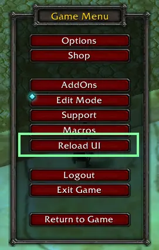
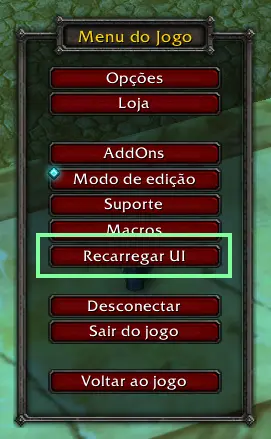

# EscReload

**English** | [Português (Brasil)](#português-brasil)

Adds a **Reload UI** button to the game menu (ESC), right above **Log Out**, so you can reload your interface in a single click.




## Features

- A "Reload UI" button in the ESC menu, placed directly above "Log Out".
- Extra slash command to reload quickly.
- Localized in English (default) and Portuguese (Brazil).
- Works across multiple game clients (see [Compatibility](#compatibility)).
- Lightweight: no settings, no saved variables, no dependencies.

## Slash commands

Use any of the following slash commands to reload your interface quickly.

| Command   | Description                                              |
|-----------|----------------------------------------------------------|
| `/rl`     | Reloads the UI (added by EscReload)                      |
| `/reload` | Reloads the UI (built into the game)                     |

Extra command:

| Command             | Description                                                          |
|---------------------|----------------------------------------------------------------------|
| `/escreload debug`  | Prints the ESC menu button layout. Useful when reporting a bug.      |

## Installation

1. Download the latest release.
2. Extract the `EscReload` folder into your AddOns directory:
   - Retail: `World of Warcraft\_retail_\Interface\AddOns\`
   - MoP Classic / TBC Classic: the matching `_classic_` folder for your client (for example `_classic_`, `_classic_era_`)
3. Restart the game, or type `/reload`.
4. Press **ESC**: the **Reload UI** button appears above **Log Out**.

## Compatibility

| Client                    | Game version | Interface |
|---------------------------|--------------|-----------|
| Retail                    | 12.1.5       | 120105    |
| Mists of Pandaria Classic | 5.5.4        | 50504     |
| TBC Classic (Anniversary) | 2.5.6        | 20506     |

Other clients (Classic Era, Forever) have not been tested yet. Reports are welcome.

You can check your client's interface number in game with:

```
/dump select(4, GetBuildInfo())
```

## Localization

The addon uses your game client language. English is the default, and Portuguese (Brazil) is also included. To add a new language, add an entry to the `LOCALES` table in `EscReload.lua`.

## Reporting issues

If the button does not show up, or appears in the wrong place:

1. Enable Lua errors with `/console scriptErrors 1`.
2. Open the ESC menu, close it, and run `/escreload debug`.
3. Open an issue with your game version, the debug output, and any error message.

---

# Português (Brasil)

Adiciona um botão **Recarregar UI** no menu do jogo (ESC), logo acima de **Desconectar**, para você recarregar a interface com um clique.



## Recursos

- Botão "Recarregar UI" no menu ESC, posicionado logo acima de "Desconectar".
- Comando extra para recarregar rapidamente.
- Disponível em inglês (padrão) e português do Brasil.
- Funciona em vários clientes do jogo (veja [Compatibilidade](#compatibilidade)).
- Leve: sem configurações, sem variáveis salvas e sem dependências.

## Comandos

Use qualquer um dos comandos abaixo para recarregar a interface rapidamente.

| Comando   | Descrição                                           |
|-----------|-----------------------------------------------------|
| `/rl`     | Recarrega a interface (adicionado pelo EscReload)   |
| `/reload` | Recarrega a interface (já existe no jogo)           |

Comando extra:

| Comando             | Descrição                                                              |
|---------------------|------------------------------------------------------------------------|
| `/escreload debug`  | Mostra o layout dos botões do menu ESC. Útil ao reportar um problema.  |

## Instalação

1. Baixe a última versão.
2. Extraia a pasta `EscReload` no diretório de AddOns:
   - Retail: `World of Warcraft\_retail_\Interface\AddOns\`
   - MoP Classic / TBC Classic: a pasta `_classic_` correspondente ao seu cliente (por exemplo `_classic_`, `_classic_era_`)
3. Reinicie o jogo ou digite `/reload`.
4. Pressione **ESC**: o botão **Recarregar UI** aparece acima de **Desconectar**.

## Compatibilidade

| Cliente                   | Versão do jogo | Interface |
|---------------------------|----------------|-----------|
| Retail                    | 12.1.5         | 120105    |
| Mists of Pandaria Classic | 5.5.4          | 50504     |
| TBC Classic (Aniversário) | 2.5.6          | 20506     |

Outros clientes (Classic Era, Forever) ainda não foram testados. Relatos são bem-vindos.

Para ver o número de interface do seu cliente, digite no jogo:

```
/dump select(4, GetBuildInfo())
```

## Idiomas

O addon usa o idioma do cliente do jogo. O inglês é o padrão e o português do Brasil também está incluído. Para adicionar um idioma, acrescente uma entrada na tabela `LOCALES` em `EscReload.lua`.

## Reportando problemas

Se o botão não aparecer ou ficar no lugar errado:

1. Ative os erros de Lua com `/console scriptErrors 1`.
2. Abra o menu ESC, feche e execute `/escreload debug`.
3. Abra uma issue com a versão do jogo, o resultado do debug e qualquer mensagem de erro.